---
title: Mermaid数据可视化演示
date: 2026-05-04 16:00:00
tags: ["工具", "教程"]
categories: ["技术教程", "工具使用"]
---

# 📊 博客数据可视化：Mermaid 图表完全指南

本文展示如何在博客中使用**Mermaid**创建精美的数据可视化图表。所有图表都是通过 Markdown 代码块直接编写，无需外部服务。

## 🔧 技术栈与插件

| 层级 | 技术/插件 | 说明 |
| --- | --- | --- |
| 博客框架 | [Hexo](https://hexo.io/)`v8.1.1` | 静态博客生成器 |
| 主题 | [Butterfly](https://butterfly.js.org/)`v5.5.4` | 内置 Mermaid 支持，配置`mermaid.code_write: true` |
| 图表引擎 | [Mermaid](https://mermaid.js.org/) | 基于 JavaScript 的图表绘制工具，支持流程图、时序图、甘特图等 |
| 语法转换 | `mermaid-convert.js` | 自研 Hexo Filter 插件，自动将````mermaid`代码块转换为 Butterfly 的`&#123;% mermaid %}`标签 |
| 样式主题 | `darkmode.css` | 自定义暗色主题变量，确保图表在 dark mode 下清晰可读 |

---

## 1. 流程图 (Flowchart)

流程图是最常用的图表类型，适合展示工作流程、决策过程等。

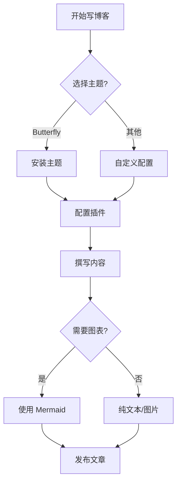

### 使用场景

- 工作流程说明
- 决策树
- 算法逻辑
- 系统架构

---

## 2. 时序图 (Sequence Diagram)

时序图用于展示对象之间的交互顺序，特别适合描述 API 调用、用户操作等场景。

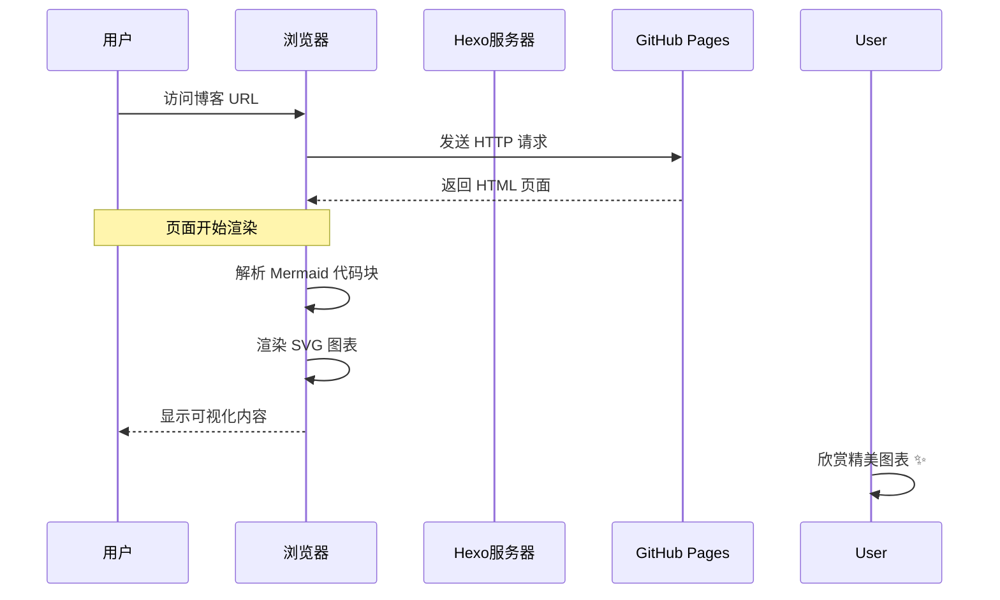

### 使用场景

- API 文档
- 用户交互流程
- 系统消息传递
- 协议说明

---

## 3. 饼图 (Pie Chart)

饼图适合展示数据占比和分布情况。

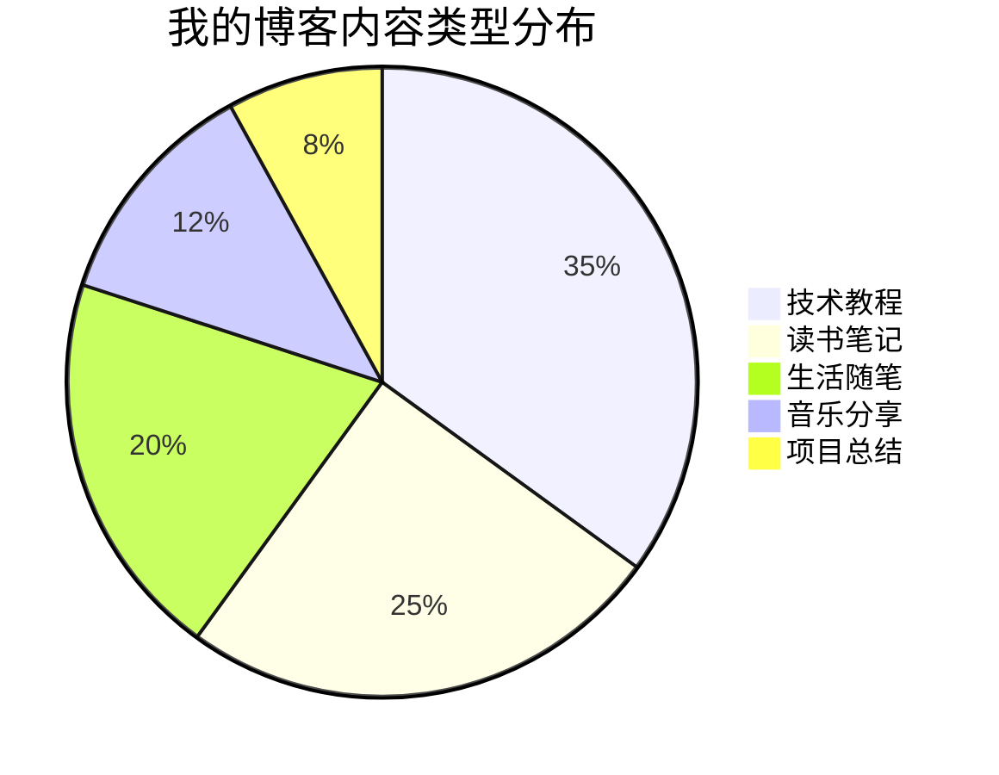

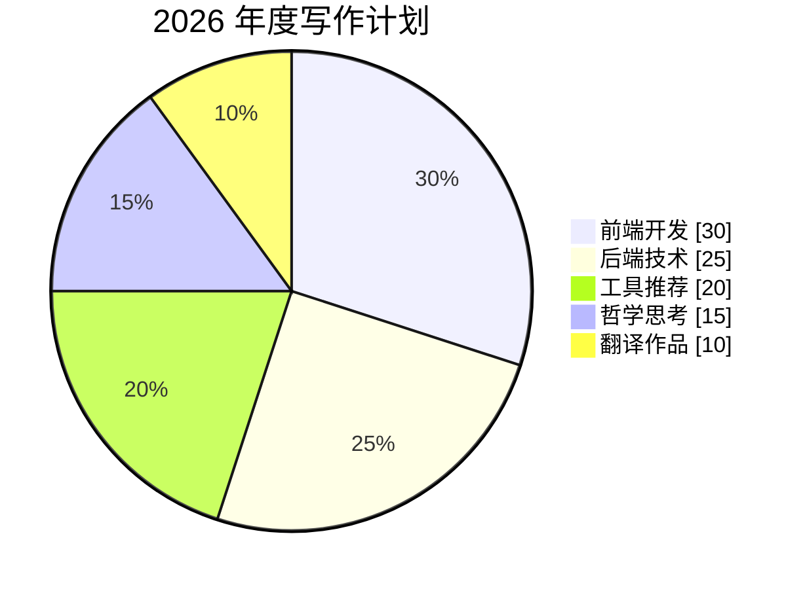

### 使用场景

- 数据统计
- 占比分析
- 时间分配
- 分类展示

---

## 4. 甘特图 (Gantt Chart)

甘特图是项目管理的好帮手，可以清晰展示任务时间线。

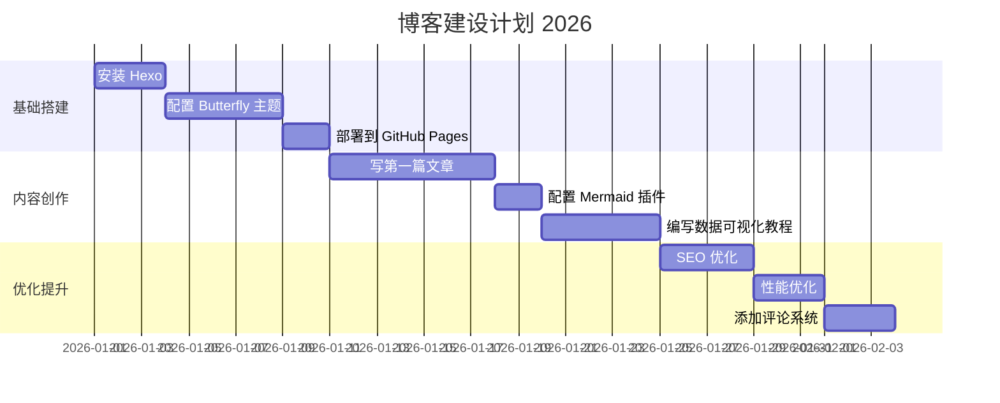

### 使用场景

- 项目进度管理
- 学习计划
- 发布路线图
- 任务依赖关系

---

## 5. 类图 (Class Diagram)

类图用于展示代码结构和面向对象设计。

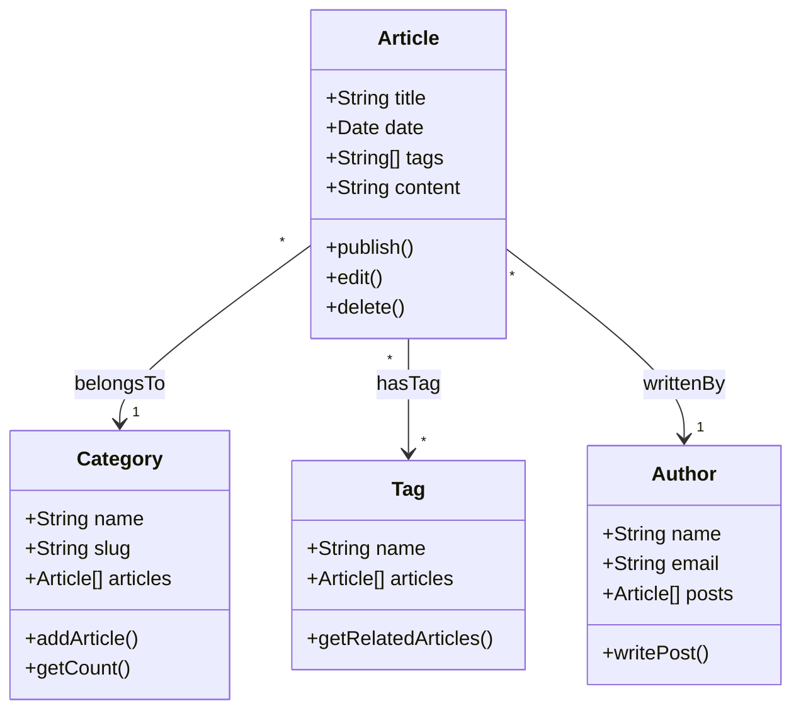

### 使用场景

- 代码文档
- 数据库设计
- API 结构说明
- 系统架构

---

## 6. 状态图 (State Diagram)

状态图用于展示对象的状态变化和转换条件。

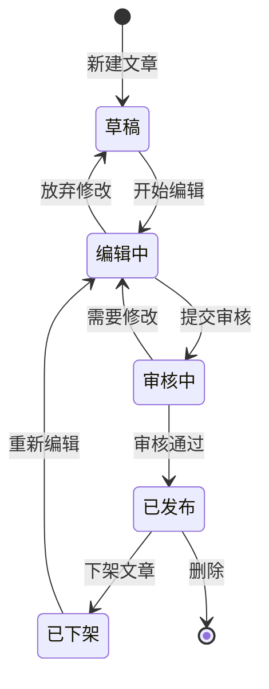

### 使用场景

- 流程状态管理
- 生命周期说明
- 业务规则
- 状态机设计

---

## 7. ER 图 (Entity Relationship)

ER 图用于展示数据库实体之间的关系。

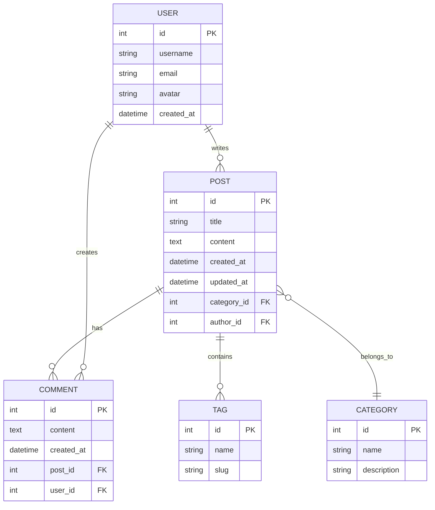

### 使用场景

- 数据库设计
- 数据模型说明
- API 关系文档
- 系统架构

---

## 8. 思维导图 (Mindmap)

思维导图适合展示层次化的知识结构。

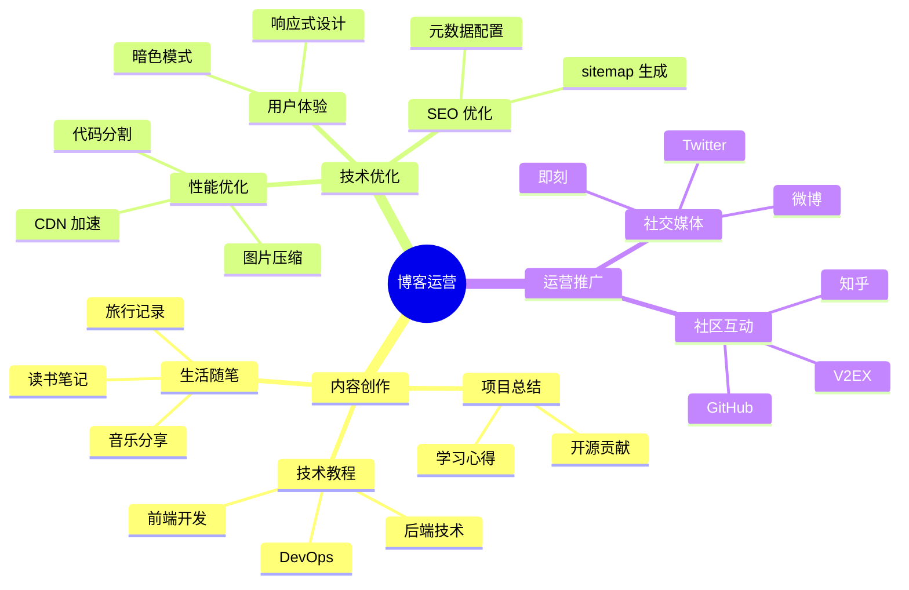

### 使用场景

- 知识整理
- 思路梳理
- 项目规划
- 学习路径

---

## 🎨 高级技巧

### 自定义样式

Mermaid 支持自定义颜色和样式：

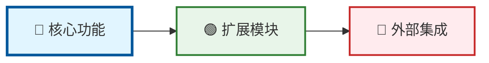

### 子图 (Subgraphs)

使用子图组织复杂图表：

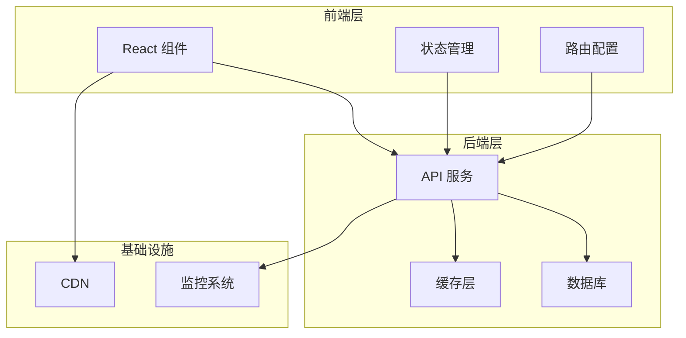

---

## 📝 使用建议

1. **保持简洁**：每个图表只表达一个核心观点
2. **合理选择**：根据数据类型选择合适的图表
3. **注意可读性**：避免过于复杂的嵌套结构
4. **添加说明**：配合文字解释图表含义
5. **测试渲染**：发布前预览确保显示正常

---

## 🔧 相关资源

- [Mermaid 官方文档](https://mermaid.js.org/intro/)
- [Mermaid 在线编辑器](https://mermaid.live/)
- [Butterfly 主题文档](https://butterfly.js.org/posts/4aa8abbe/)

---

> 💡**提示**：本文所有图表都是实时渲染的 SVG，支持缩放和打印，且无需加载任何外部图片资源。