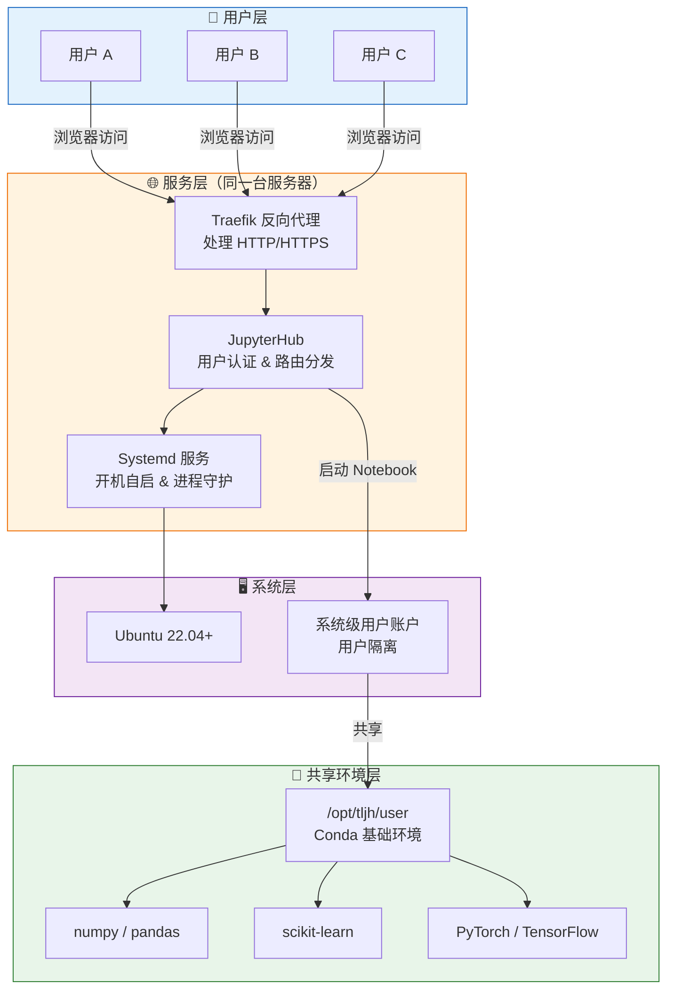
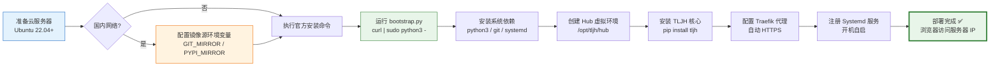
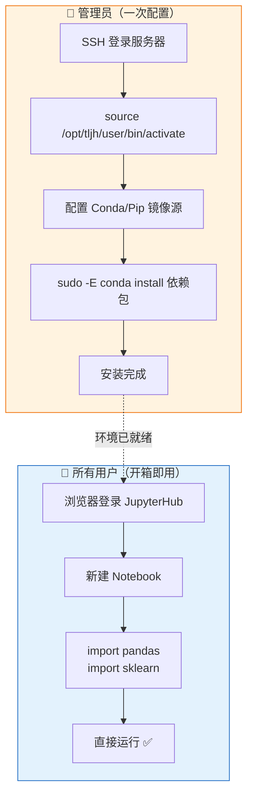

---
title: TLJH-轻量级-JupyterHub-部署指南
date: 2026-05-06 06:00:00
tags: ["DevOps", "教程", "数据科学"]
categories: ["技术教程", "DevOps"]
---

# TLJH 轻量级 JupyterHub 部署指南

---

## 目录

1. [TLJH 是什么，为什么选它](#%E4%B8%80tljh-%E6%98%AF%E4%BB%80%E4%B9%88%E4%B8%BA%E4%BB%80%E4%B9%88%E9%80%89%E5%AE%83)
2. [连接服务器](#%E4%BA%8C%E8%BF%9E%E6%8E%A5%E6%9C%8D%E5%8A%A1%E5%99%A8)
3. [部署 TLJH](#%E4%B8%89%E9%83%A8%E7%BD%B2-tljh)
4. [全局 Python 环境配置](#%E5%9B%9B%E5%85%A8%E5%B1%80-python-%E7%8E%AF%E5%A2%83%E9%85%8D%E7%BD%AE)
5. [附：一键下载安装脚本](#%E4%BA%94%E9%99%84%E4%B8%80%E9%94%AE%E4%B8%8B%E8%BD%BD%E5%AE%89%E8%A3%85%E8%84%9A%E6%9C%AC)

---

## 一、TLJH 是什么，为什么选它

### 1.1 一台服务器 = 整个团队的开发环境

[The Littlest JupyterHub](https://tljh.jupyter.org/)（简称**TLJH**）是 Jupyter 官方出品的**轻量级多用户计算平台**。它的核心卖点极其简单：

> **用一台普通的 Linux 服务器，给整个团队提供浏览器即开即用的 Jupyter 环境。**

部署完成后，你只需要把服务器 IP 发给同事。对方打开浏览器、输入账号，就能立刻获得一个独立的 Jupyter 工作空间——而你提前装好的`pandas`、`scikit-learn`、`PyTorch`等库，所有人开箱即用。

### 1.2 资源紧张时的最优解：TLJH vs 原版 JupyterHub

JupyterHub 本身已经是一个成熟的多用户 Jupyter 平台，但它默认面向的是中大型组织：需要独立的数据库、可扩展的代理层、复杂的认证配置。TLJH（The Littlest JupyterHub）是 Jupyter 官方针对**单服务器场景**做的精简发行版，核心差异在于**资源紧张时的 trade-off 设计**。

| 对比维度 | **TLJH** | 原版 JupyterHub（手动部署） |
| --- | --- | --- |
| **服务器数量** | 1 台即可 | 至少 2 台（Hub + 代理/数据库分离） |
| **最低配置** | 2核4G 云服务器 | 4核8G 起步，独立数据库额外消耗资源 |
| **部署方式** | 一条命令，5 分钟 | 手动配置 Hub、Proxy、数据库、Systemd |
| **用户隔离** | 系统级用户 + 共享 Conda 环境 | 容器/Docker 隔离，每个用户独立镜像 |
| **资源占用** | 仅 128MB 基础开销 | 单用户容器即数百 MB，Hub 本身另算 |
| **扩展上限** | 1-100 人 | 无上限，但每增一台节点都增加成本 |

**关键 trade-off 在于用户隔离级别**：

- **原版 JupyterHub**默认推荐 Docker 隔离，每个用户独立容器。这确实更安全、更”云原生”，但在 2核4G 的服务器上，启动 5 个用户实例就能把内存吃满。
- **TLJH 的选择是系统级用户 + 共享 Python 环境**。所有用户跑在同一个操作系统上，共享`/opt/tljh/user`下的 Conda 环境。没有容器开销，没有镜像层叠，128MB 的基础内存就能撑起 Hub 本身，剩下的资源全部留给用户的实际计算。

**结论**：如果你只有一台服务器、团队不到 100 人，TLJH 是**唯一能在资源紧张情况下跑起来的方案**。它牺牲了容器级的强隔离，换来了在有限硬件上服务更多用户的能力——对于内部信任的团队环境，这是完全合理的取舍。

### 1.3 TLJH 架构一览



### 1.4 这些场景，TLJH 是绝配

- **教学/培训**：老师预装好课程环境，学生登录即用，告别”环境配置第一课”
- **数据分析团队**：统一 Python 版本和依赖，彻底消灭”在我电脑上能跑”
- **轻量 GPU 共享**：单卡服务器多用户分时使用，比 Docker 方案更省显存
- **远程开发环境**：替代本地 Anaconda，随时随地浏览器访问，换电脑无感迁移

---

## 二、 连接服务器

本文默认你使用云服务器（腾讯云、阿里云、华为云等）。

1. **获取服务器信息**：公网 IP、管理员账号（通常为`root`）、密码
2. **打开终端**：
  - Windows：按 `Win + R` 输入 `cmd`，或打开 PowerShell
  - macOS/Linux：打开 Terminal
3. **建立 SSH 连接**：ssh root@<服务器公网IP>
4. **身份验证**：
  - 首次连接若出现安全确认提示，输入 `yes` 并回车
  - 输入密码（Linux 输入密码时无回显，输入完直接回车即可）

---

## 三、 部署 TLJH

### 3.1 系统要求

- **操作系统**：Ubuntu 22.04+ 或 Debian 11+
- **架构**：amd64 或 arm64
- **最低配置**：2 核 CPU / 4GB 内存 / 20GB 磁盘
- **推荐配置**：4 核 CPU / 8GB 内存 / 50GB 磁盘（10 人以内团队）

### 3.2 核心问题：国内云服务器安装慢，怎么办？

这是本文**最关键的部分**。

TLJH 的官方安装脚本需要从 GitHub 拉取代码、从 PyPI 安装依赖。但国内云服务器访问 GitHub 和官方 PyPI 的速度极慢，甚至直接超时。**你不需要为整台服务器配置代理**，只需要在安装时临时指定镜像源即可。

**解决方案：使用环境变量注入镜像地址**

TLJH 的安装脚本支持通过环境变量配置镜像，无需修改脚本本身。执行以下命令（将末尾的`admin`替换为你想要的管理员用户名）：

```bash
export TLJH_GIT_MIRROR="https://ghproxy.net/"
export TLJH_PYPI_MIRROR="https://pypi.tuna.tsinghua.edu.cn/simple"
curl -L https://tljh.jupyter.org/bootstrap.py | sudo python3 - --admin admin
```

**原理说明**：

- `TLJH_GIT_MIRROR`：代理 GitHub  raw 内容和 git 仓库请求。`ghproxy.net`是国内常用的 GitHub 加速服务，你也可以替换为`https://mirror.ghproxy.com/`或其他可信代理
- `TLJH_PYPI_MIRROR`：代理 Python 包下载。`pypi.tuna.tsinghua.edu.cn`是清华大学 TUNA 镜像站，稳定且同步及时

**如果你的服务器在海外，或已有其他代理方式**，直接执行官方命令即可，无需上述环境变量：

```bash
curl -L https://tljh.jupyter.org/bootstrap.py | sudo python3 - --admin admin
```

### 3.3 部署流程图



### 3.4 等待安装完成

安装过程通常需要**5-15 分钟**，终端会持续输出日志。当看到`Done!`或回到命令提示符时，说明部署完成。

安装期间，TLJH 会自动完成以下事情：

- 安装 Python 3、pip、git 等基础依赖
- 创建隔离的 Hub 环境和用户环境
- 配置 systemd 服务，确保开机自启
- 设置 Traefik 反向代理，自动处理 HTTP/HTTPS

---

## 四、 全局 Python 环境配置

### 4.1 为什么需要全局配置

TLJH 默认在`/opt/tljh/user`路径下内置了基于 Miniforge 的 Conda 环境，**无需自行安装 Anaconda/Miniforge**。所有普通用户默认共享该环境下的 Python 库。

这意味着：**管理员只需安装一次，所有用户都能用。**

### 4.2 环境配置流程



### 4.3 登录网页端验证

在浏览器地址栏输入服务器的公网 IP，进入 JupyterHub 登录页面：

- 用户名：安装时设置的 admin 用户名
- 密码：首次输入的密码会被自动设为永久密码

### 4.3 激活全局环境并配置镜像源

通过 SSH 连接到服务器后，系统默认不会加载 TLJH 的共享环境。在安装库之前，**必须先手动激活**：

```bash
source /opt/tljh/user/bin/activate
```

激活成功后，命令行提示符前会出现`(base)`或类似标识。

**配置 Conda 镜像源**（以清华大学镜像为例）：

```bash
sudo -E conda config --env --add channels https://mirrors.tuna.tsinghua.edu.cn/anaconda/cloud/conda-forge/
sudo -E conda config --env --add channels https://mirrors.tuna.tsinghua.edu.cn/anaconda/pkgs/main/
sudo -E conda config --env --add channels https://mirrors.tuna.tsinghua.edu.cn/anaconda/pkgs/free/
sudo -E conda config --env --set show_channel_urls yes
sudo -E conda config --env --remove channels defaults
```

> 注意：`sudo -E`是必需的，它确保在 root 权限下继承当前已激活的 Conda 环境变量。

**配置 Pip 镜像源**：

```bash
sudo -E pip config set global.index-url https://pypi.tuna.tsinghua.edu.cn/simple
```

> 如果你不需要国内镜像，可以跳过上述配置，直接使用默认源。

### 4.4 为全体用户统一安装 Python 库

保持环境激活状态，使用以下命令安装团队所需的库：

**使用 Conda 安装（推荐，依赖冲突更少）**：

```bash
sudo -E conda install numpy pandas matplotlib scikit-learn
```

**使用 Pip 安装**：

```bash
sudo -E pip install numpy pandas matplotlib scikit-learn
```

安装完成后，JupyterHub 上的所有普通用户即可直接`import`这些库，无需各自重复配置。

---

## 五、附：一键下载安装脚本

以下是我基于官方脚本修改的**通用版 bootstrap 脚本**，核心改进是**支持通过环境变量灵活配置镜像源**，无需修改脚本本身。

**使用方法**：

```bash
# 国内用户（配置镜像）
export TLJH_GIT_MIRROR="https://ghproxy.net/"
export TLJH_PYPI_MIRROR="https://pypi.tuna.tsinghua.edu.cn/simple"
curl -L <脚本地址> | sudo python3 - --admin admin

# 海外用户（无需镜像）
curl -L <脚本地址> | sudo python3 - --admin admin
```

**脚本源码**（点击上方按钮直接下载）：
tljh-bootstrap.py下载文件

```python
"""
Bootstrap an installation of TLJH (The Littlest JupyterHub).

This is a general-purpose bootstrap script with configurable mirror support.

Usage:
    curl -L <script-url> | sudo python3 - --admin <admin_username>

Environment variables:
    TLJH_INSTALL_PREFIX         Defaults to "/opt/tljh"
    TLJH_BOOTSTRAP_PIP_SPEC     pip spec for tljh installer
    TLJH_BOOTSTRAP_DEV          yes/no for editable install
    TLJH_GIT_MIRROR             GitHub mirror prefix (default: "")
                                e.g. "https://ghproxy.net/" for China users
    TLJH_PYPI_MIRROR            PyPI mirror URL (default: "")
                                e.g. "https://pypi.tuna.tsinghua.edu.cn/simple"
"""

import logging
import multiprocessing
import os
import re
import shutil
import subprocess
import sys
import urllib.request
from argparse import ArgumentParser
from http.server import HTTPServer, SimpleHTTPRequestHandler

# Configurable mirrors via environment variables
GIT_MIRROR = os.environ.get("TLJH_GIT_MIRROR", "")
PYPI_MIRROR = os.environ.get("TLJH_PYPI_MIRROR", "")

progress_page_favicon_url = (
    f"{GIT_MIRROR}https://raw.githubusercontent.com/jupyterhub/jupyterhub/main/"
    "share/jupyterhub/static/favicon.ico"
)
progress_page_html = """
<html>
<head>
  <title>The Littlest Jupyterhub</title>
</head>
<body>
  <meta http-equiv="refresh" content="30" >
  <meta http-equiv="content-type" content="text/html; charset=utf-8">
  <meta name="viewport" content="width=device-width">
  
  <div class="loader center"></div>
  <div class="center main-msg">Please wait while your TLJH is setting up...</div>
  <div class="center logs-msg">Click the button below to see the logs</div>
  <div class="center tip" >Tip: to update the logs, refresh the page</div>
  <button class="logs-button center" onclick="window.location.href='/logs'">View logs</button>
</body>

  <style>
    button:hover {{
      background: grey;
    }}

    .logo {{
      width: 150px;
      height: auto;
    }}
    .center {{
      margin: 0 auto;
      margin-top: 50px;
      text-align:center;
      display: block;
    }}
    .main-msg {{
      font-size: 30px;
      font-weight: bold;
      color: grey;
      text-align:center;
    }}
    .logs-msg {{
      font-size: 15px;
      color: grey;
    }}
    .tip {{
      font-size: 13px;
      color: grey;
      margin-top: 10px;
      font-style: italic;
    }}
    .logs-button {{
      margin-top:15px;
      border: 0;
      color: white;
      padding: 15px 32px;
      font-size: 16px;
      cursor: pointer;
      background: #f5a252;
    }}
    .loader {{
      width: 150px;
      height: 150px;
      border-radius: 90%;
      border: 7px solid transparent;
      animation: spin 2s infinite ease;
      animation-direction: alternate;
    }}
    @keyframes spin {{
      0% {{
        transform: rotateZ(0deg);
        border-top-color: #f17c0e
      }}
      100% {{
        transform: rotateZ(360deg);
        border-top-color: #fce5cf;
      }}
    }}
  </style>
</head>
</html>
""".format(git_mirror=GIT_MIRROR)

logger = logging.getLogger(__name__)


def _parse_version(vs):
    """Parse a simple version into a tuple of ints"""
    return tuple(int(part) for part in vs.split("."))


def run_subprocess(cmd, *args, **kwargs):
    """
    Run given cmd with smart output behavior.
    If command succeeds, print output to debug logging.
    If it fails, print output to info logging.
    """
    logger = logging.getLogger("tljh")
    proc = subprocess.run(
        cmd, stdout=subprocess.PIPE, stderr=subprocess.STDOUT, *args, **kwargs
    )
    printable_command = " ".join(cmd)
    if proc.returncode != 0:
        logger.error(
            "Ran {command} with exit code {code}".format(
                command=printable_command, code=proc.returncode
            )
        )
        logger.error(proc.stdout.decode())
        raise subprocess.CalledProcessError(cmd=cmd, returncode=proc.returncode)
    else:
        logger.debug(
            "Ran {command} with exit code {code}".format(
                command=printable_command, code=proc.returncode
            )
        )
        output = proc.stdout.decode()
        logger.debug(output)
        return output


def get_os_release_variable(key):
    """Return value for key from /etc/os-release"""
    return (
        subprocess.check_output(
            [
                "/bin/bash",
                "-c",
                "source /etc/os-release && echo ${{{key}}}".format(key=key),
            ]
        )
        .decode()
        .strip()
    )


def ensure_host_system_can_install_tljh():
    """Check if TLJH is installable in current host system."""
    distro = get_os_release_variable("ID")
    version = get_os_release_variable("VERSION_ID")
    if distro not in ["ubuntu", "debian"]:
        print("The Littlest JupyterHub currently supports Ubuntu or Debian Linux only")
        sys.exit(1)
    elif distro == "ubuntu" and _parse_version(version) < (22, 4):
        print("The Littlest JupyterHub requires Ubuntu 22.04 or higher")
        sys.exit(1)
    elif distro == "debian" and _parse_version(version) < (11,):
        print("The Littlest JupyterHub requires Debian 11 or higher")
        sys.exit(1)

    if sys.version_info < (3, 9):
        print(f"bootstrap.py must be run with at least Python 3.9, found {sys.version}")
        sys.exit(1)

    if not shutil.which("systemd") or not shutil.which("systemctl"):
        print("Systemd is required to run TLJH")
        if os.path.exists("/.dockerenv"):
            print("Running inside a docker container without systemd isn't supported")
            print("For local development, see http://tljh.jupyter.org/en/latest/contributing/dev-setup.html")
        sys.exit(1)
    return distro, version


class ProgressPageRequestHandler(SimpleHTTPRequestHandler):
    def do_GET(self):
        if self.path == "/logs":
            with open("/opt/tljh/installer.log") as log_file:
                logs = log_file.read()
            self.send_response(200)
            self.send_header("Content-Type", "text/plain; charset=utf-8")
            self.end_headers()
            self.wfile.write(logs.encode("utf-8"))
        elif self.path == "/index.html":
            self.path = "/var/run/index.html"
            return SimpleHTTPRequestHandler.do_GET(self)
        elif self.path == "/favicon.ico":
            self.path = "/var/run/favicon.ico"
            return SimpleHTTPRequestHandler.do_GET(self)
        elif self.path == "/":
            self.send_response(302)
            self.send_header("Location", "/index.html")
            self.end_headers()
        else:
            SimpleHTTPRequestHandler.send_error(self, code=403)


def _find_matching_version(all_versions, requested):
    """Find the latest version that is less than or equal to requested."""
    sorted_versions = sorted(all_versions, reverse=True)
    if requested == "latest":
        return sorted_versions[0]
    components = len(requested)
    for v in sorted_versions:
        if v[:components] == requested:
            return v
    return None


def _resolve_git_version(version):
    """Resolve the version argument to a git ref using git ls-remote."""
    if version != "latest" and not re.match(r"\d+(\.\d+)?(\.\d+)?$", version):
        return version

    all_versions = set()
    git_url = (
        f"{GIT_MIRROR}https://github.com/jupyterhub/the-littlest-jupyterhub.git"
    )
    out = run_subprocess(
        ["git", "ls-remote", "--tags", "--refs", git_url]
    )

    for line in out.splitlines():
        m = re.match(r"(?P<sha>[a-f0-9]+)\s+refs/tags/(?P<tag>[\S]+)$", line)
        if not m:
            raise Exception("Unexpected git ls-remote output: {}".format(line))
        tag = m.group("tag")
        if tag == version:
            return tag
        if re.match(r"\d+\.\d+\.\d+$", tag):
            all_versions.add(tuple(int(v) for v in tag.split(".")))

    if not all_versions:
        raise Exception("No MAJOR.MINOR.PATCH git tags found")

    requested = "latest" if version == "latest" else tuple(int(v) for v in version.split("."))
    found = _find_matching_version(all_versions, requested)
    if not found:
        raise Exception(
            "No version matching {} found {}".format(version, sorted(all_versions))
        )
    return ".".join(str(f) for f in found)


def main():
    distro, version = ensure_host_system_can_install_tljh()

    parser = ArgumentParser(
        description="Bootstrap script for The Littlest JupyterHub"
    )
    parser.add_argument(
        "--show-progress-page",
        action="store_true",
        help="Start a local web server on port 80 to show installation progress",
    )
    parser.add_argument(
        "--version",
        default="",
        help="TLJH version or Git reference (default: latest)",
    )
    args, tljh_installer_flags = parser.parse_known_args()

    install_prefix = os.environ.get("TLJH_INSTALL_PREFIX", "/opt/tljh")
    hub_env_prefix = os.path.join(install_prefix, "hub")
    hub_env_python = os.path.join(hub_env_prefix, "bin", "python3")
    hub_env_pip = os.path.join(hub_env_prefix, "bin", "pip")
    initial_setup = not os.path.exists(hub_env_python)

    if args.show_progress_page:
        with open("/var/run/index.html", "w+") as f:
            f.write(progress_page_html)
        urllib.request.urlretrieve(progress_page_favicon_url, "/var/run/favicon.ico")

        try:
            def serve_forever(server):
                try:
                    server.serve_forever()
                except KeyboardInterrupt:
                    pass

            progress_page_server = HTTPServer(("", 80), ProgressPageRequestHandler)
            p = multiprocessing.Process(
                target=serve_forever, args=(progress_page_server,)
            )
            p.start()
            tljh_installer_flags.extend(["--progress-page-server-pid", str(p.pid)])
        except OSError:
            pass

    os.makedirs(install_prefix, exist_ok=True)
    file_logger_path = os.path.join(install_prefix, "installer.log")
    file_logger = logging.FileHandler(file_logger_path)
    os.chmod(file_logger_path, 0o500)

    file_logger.setFormatter(logging.Formatter("%(asctime)s %(message)s"))
    file_logger.setLevel(logging.DEBUG)
    logger.addHandler(file_logger)

    stderr_logger = logging.StreamHandler()
    stderr_logger.setFormatter(logging.Formatter("%(message)s"))
    stderr_logger.setLevel(logging.INFO)
    logger.addHandler(stderr_logger)

    logger.setLevel(logging.DEBUG)

    if not initial_setup:
        logger.info("Existing TLJH installation detected, upgrading...")
    else:
        logger.info("Existing TLJH installation not detected, installing...")
        logger.info("Setting up hub environment...")
        logger.info("Installing Python, venv, pip, and git via apt-get...")

        apt_get_adjusted_env = os.environ.copy()
        apt_get_adjusted_env["DEBIAN_FRONTEND"] = "noninteractive"
        run_subprocess(["apt-get", "update"])
        run_subprocess(
            ["apt-get", "install", "--yes", "software-properties-common"],
            env=apt_get_adjusted_env,
        )
        if distro == "ubuntu":
            run_subprocess(["add-apt-repository", "universe", "--yes"])
        run_subprocess(["apt-get", "update"])
        run_subprocess(
            [
                "apt-get",
                "install",
                "--yes",
                "python3",
                "python3-venv",
                "python3-pip",
                "git",
                "sudo",
            ],
            env=apt_get_adjusted_env,
        )

        logger.info("Setting up virtual environment at {}".format(hub_env_prefix))
        os.makedirs(hub_env_prefix, exist_ok=True)
        run_subprocess(["python3", "-m", "venv", hub_env_prefix])

    logger.info("Upgrading pip...")
    pip_upgrade_cmd = [hub_env_pip, "install", "--upgrade", "pip"]
    if PYPI_MIRROR:
        pip_upgrade_cmd.extend(["-i", PYPI_MIRROR])
    run_subprocess(pip_upgrade_cmd)

    tljh_install_cmd = [hub_env_pip, "install", "--upgrade"]
    if PYPI_MIRROR:
        tljh_install_cmd.extend(["-i", PYPI_MIRROR])

    bootstrap_pip_spec = os.environ.get("TLJH_BOOTSTRAP_PIP_SPEC")
    if args.version or not bootstrap_pip_spec:
        version_to_resolve = args.version or "latest"
        bootstrap_pip_spec = (
            "git+{git_mirror}https://github.com/jupyterhub/the-littlest-jupyterhub.git@{}".format(
                GIT_MIRROR,
                _resolve_git_version(version_to_resolve)
            )
        )
    elif os.environ.get("TLJH_BOOTSTRAP_DEV", "no") == "yes":
        logger.info("Selected TLJH_BOOTSTRAP_DEV=yes...")
        tljh_install_cmd.append("--editable")
    tljh_install_cmd.append(bootstrap_pip_spec)

    if initial_setup:
        logger.info("Installing TLJH installer...")
    else:
        logger.info("Upgrading TLJH installer...")
    run_subprocess(tljh_install_cmd)

    logger.info("Running TLJH installer...")
    os.execv(
        hub_env_python, [hub_env_python, "-m", "tljh.installer"] + tljh_installer_flags
    )


if __name__ == "__main__":
    main()
```


---

## 参考链接
- [TLJH 官方文档](https://tljh.jupyter.org/en/latest/)
- [TLJH GitHub 仓库](https://github.com/jupyterhub/the-littlest-jupyterhub)
- [JupyterHub 官方文档](https://jupyterhub.readthedocs.io/)