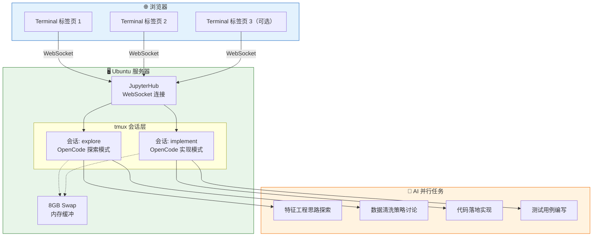
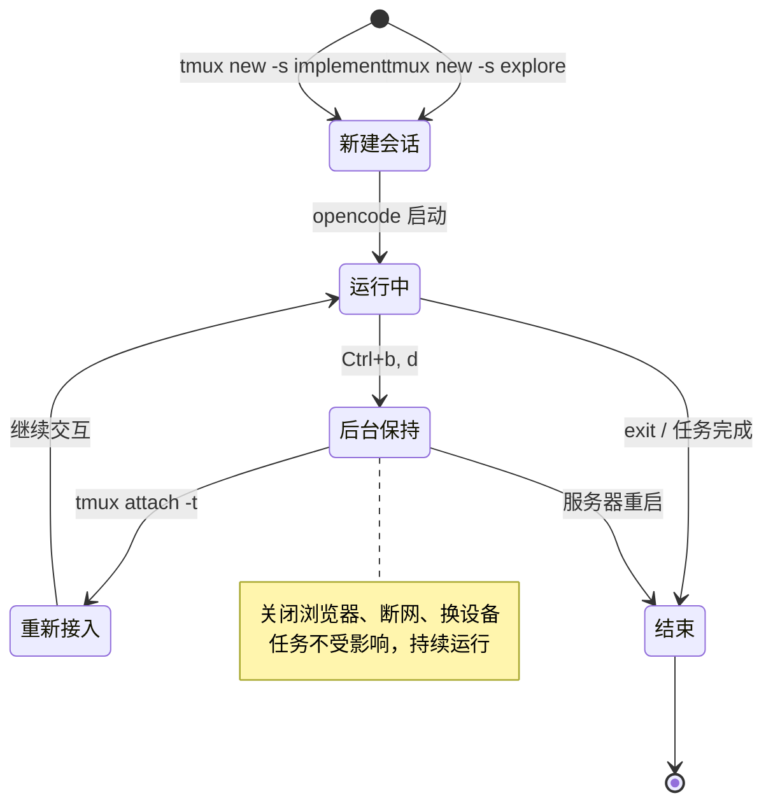

---
title: 在JupyterHub-Terminal-里用-OpenCode-做-AI-并行开发
date: 2026-05-09 04:00:00
tags: ["DevOps", "工具", "教程"]
categories: ["技术教程", "DevOps"]
---

# 在 JupyterHub Terminal 里用 OpenCode 做 AI 并行开发

> JupyterHub 的 Terminal 是一个被严重低估的功能。大多数人只用 JupyterHub 跑 Notebook，却不知道那个不起眼的 Terminal 图标背后，藏着一个完整的 Linux 终端——它足以支撑 AI 辅助的并行开发工作流。本文介绍如何用 JupyterHub Terminal + tmux + OpenCode，在浏览器中搭建一个轻量但完整的 AI 并行开发环境。如果你的服务器资源本就不宽裕，这套方案几乎不增加任何额外开销。

---

## 为什么是 JupyterHub Terminal

### JupyterHub 的 Terminal：被忽视的入口

JupyterHub 在学术和团队场景中极为常见——实验室共享服务器、课程教学平台、企业数据分析环境，到处都有它的身影。但绝大多数用户对 JupyterHub 的使用停留在 Notebook 界面：写 Python、跑实验、看图表。

Launcher 里那个`Terminal`按钮，很少有人点开。

这很可惜。JupyterHub 的 Terminal 本质上是一个完整的 Bash 终端，直接运行在服务器上。它不需要额外安装，不需要配置 SSH 密钥，不需要本地安装任何客户端——打开浏览器就能用。对于已经部署了 JupyterHub 的环境来说，它是一个零成本的 Linux 工作入口。

### 资源紧张：为什么这很重要

在共享服务器或低配置云实例（2C4G 甚至更低）上，每一兆内存都很珍贵。VS Code Server 启动就要吃掉 1G+ 内存，远程桌面方案更不必说。而 Terminal 是纯文本界面，几乎不占额外资源——它本身就在服务器上运行，没有额外的渲染开销。

这意味着：你不需要为了获得一个”像样的开发环境”而挤占本就紧张的内存。Terminal 把省下来的资源全部留给你的实际任务。

### 这套方案的核心价值

把 JupyterHub Terminal 作为入口，搭配 tmux（会话持久化）和 OpenCode（AI 编程助手），你得到的是：

- **浏览器即开发环境**：无需本地安装任何工具，打开网页就能开始工作
- **会话不中断**：tmux 将终端会话与浏览器连接解耦，关浏览器、断网、换设备——任务照跑
- **AI 并行开发**：两个 tmux 会话各跑一个 OpenCode 实例，一个探索、一个实现，并行推进
- **零额外开销**：Terminal + tmux 的内存占用可以忽略不计，资源全部留给实际任务

---

## 整体思路

- **环境**：Ubuntu 云服务器（已部署 JupyterHub）+ Terminal + tmux + OpenCode
- **任务拆分**：一个 Terminal 负责”探索”（如特征工程思路），另一个负责”实现”（如特征代码落地），并行运行
- **后台保护**：每个任务被放入独立的 tmux 会话。关闭浏览器或网络中断后，任务仍会在服务器后台继续执行

如果不使用 tmux 而直接在 Terminal 中运行任务，一旦关闭标签页或网络波动，任务大概率会被终止。除极短测试外，全程使用 tmux 是稳妥的做法。

### 工作流架构



---

## 1. 前置操作（仅初次需要）

### 1.1 开启 8 GB Swap（需 sudo）

对于 4G 内存的服务器，Swap 不是可选项，而是**必需品**。OpenCode 运行时会占用一定内存，加上 Python 数据处理，物理内存很快耗尽。没有 Swap，OOM Killer 会直接终止你的进程。

```bash
sudo fallocate -l 8G /swapfile
sudo chmod 600 /swapfile
sudo mkswap /swapfile
sudo swapon /swapfile
echo '/swapfile none swap sw 0 0' | sudo tee -a /etc/fstab
```

完成后执行`free -h`，确认 Swap 一行显示`8.0Gi`。若当前账号无 sudo 权限，可将上述命令转发至服务器管理员执行。

### 1.2 安装 tmux

```bash
sudo apt update && sudo apt install tmux -y
```

### 1.3 安装 Node.js 20+ 与 OpenCode

OpenCode 依赖 Node.js ≥ 20。若服务器已有合适版本，可跳过 Node.js 安装。

查看当前版本：

```bash
node -v
```

版本低于 20 时，推荐使用 nvm 安装（避免与系统已有 Node 冲突）：

```bash
curl -o- https://raw.githubusercontent.com/nvm-sh/nvm/v0.40.3/install.sh | bash
source ~/.bashrc
nvm install 20
nvm alias default 20
```

随后安装 OpenCode（全局）：

```bash
npm install -g opencode
```

关闭当前 Terminal 并重新打开一个，执行`opencode --version`验证。

---

## 2. 上传本地 skills 文件夹并覆盖 OpenCode 全局路径

OpenCode 从`~/.config/opencode/skills/<技能名>/SKILL.md`读取知识库。本步骤将你本地整份 skills 文件夹上传至服务器，并以`cp -r`完整覆盖到对应技能目录。

### 2.1 通过 JupyterHub 直接上传文件夹

在 JupyterHub 的文件管理界面（地址栏通常以`/tree`结尾），将你电脑上的`skills`文件夹整体拖拽到文件列表区域，即可上传。上传完成后，该文件夹会出现在服务器主目录下（例如`/home/你的用户名/skills`）。

### 2.2 覆盖到 OpenCode 技能目录

假设你打算使用的技能名称为`feature-engineering`，执行以下命令，将上传的`skills`文件夹内容完整复制到目标位置：

```bash
rm -rf ~/.config/opencode/skills/feature-engineering
mkdir -p ~/.config/opencode/skills/feature-engineering
cp -r ~/skills/* ~/.config/opencode/skills/feature-engineering/
```

验证核心文件已就位：

```bash
cat ~/.config/opencode/skills/feature-engineering/SKILL.md
```

若正常输出你的 skills 内容，即表示部署完成。之后启动 OpenCode 时，它会自动识别并加载该目录下的知识。

---

## 3. 并行运行两个任务

### 3.1 打开两个 Terminal 标签页

在 JupyterHub 的 Launcher 中点击两次`Terminal`，获得两个并排的终端标签页。

### 3.2 tmux 会话生命周期



### 3.3 左侧 Terminal：探索任务

```bash
tmux new -s explore
opencode
```

### 3.4 右侧 Terminal：实现任务

```bash
tmux new -s implement
opencode
```

**退出但保持任务运行**：依次按下`Ctrl+b`，然后按`d`。
**重新进入查看**：在任意 Terminal 中执行`tmux attach -t explore`或`tmux attach -t implement`。

具体的任务描述、操作方式等，在 OpenCode 交互界面内完成即可，详细用法请查阅[OpenCode 官方中文文档](https://opencode.ai/docs/zh-cn/)。

---

## 4. 资源监控（第三个 Terminal，推荐）

打开第三个 Terminal 标签页，使用 btop 实时观察内存与 Swap 使用情况：

```bash
sudo apt install btop -y
btop
```

按`q`退出监控。

在资源紧张的环境下，养成监控习惯尤为重要。当你发现 Swap 使用率持续走高，说明物理内存已经不够用了——此时可以考虑降低并行度，让一个任务跑完再开下一个。

---

## 5. 常见问题

| 现象 | 可能原因 | 处理方式 |
| --- | --- | --- |
| `opencode`提示 command not found | 安装未完成或 PATH 未刷新 | 重新打开 Terminal 再试 |
| `tmux attach`无法进入会话 | 会话已丢失（如服务器重启） | 执行`tmux ls`查看；若列表为空，需重建会话 |
| 任务运行缓慢或中断 | 内存紧张 | 在 btop 中确认 Swap 已启用；若 Swap 也耗尽，可考虑降低并行度 |
| 上传的文件夹名称非`skills` | 上传时保留了原名 | 将后续命令中的`~/skills`替换为实际文件夹名 |
| JupyterHub Terminal 打不开 | 浏览器拦截了弹窗 | 允许站点弹窗，或手动在新标签页打开 |

---

## 6. 补充说明

- 两个任务建议使用不同的输出路径或文件名，避免互相覆盖。
- Swap 文件无需删除，可保留供后续使用。
- 即使关闭浏览器，只要 tmux 会话存在，任务就不会中断。
- 如果服务器重启，tmux 会话会丢失，需要重新创建。但 OpenCode 的 skills 配置不会丢失。

---

## 7. 为什么这样好：方案的价值

回到开头的问题：为什么要在 JupyterHub Terminal 里做这件事？

**Terminal 是 JupyterHub 的隐藏能力**。它不需要额外部署，不需要管理员审批，不需要安装客户端——只要你有 JupyterHub 的账号，你就有一个完整的 Linux 终端。这是零门槛的起点。

**tmux 让终端会话脱离浏览器而存在**。JupyterHub 的 Terminal 依赖 WebSocket 连接，网络一断，终端就冻结。但 tmux 把进程挂在服务器后台，与前端连接完全解耦。你可以在手机上打开 JupyterHub 查看进度，也可以关掉电脑去吃饭——回来`tmux attach`，一切如初。

**OpenCode 让 Terminal 从”命令行”升级为”AI 工作站”**。纯终端的操作门槛不低，但 OpenCode 的 TUI 界面降低了交互复杂度。更重要的是，通过 skills 机制，你可以把领域知识注入 AI，让它按照你的规范和思路工作——这不是通用聊天机器人，而是装了”领域大脑”的专属助手。

**并行是效率的倍增器**。探索和实现是两种不同的认知模式：探索需要发散思维，实现需要聚焦执行。串行切换会浪费大量上下文切换的时间。两个 tmux 会话各跑一个 OpenCode，一边试错一边落地，整体效率接近翻倍。在资源有限的环境下，这种时间节省尤为珍贵。

**资源零浪费**。Terminal + tmux 的内存占用可以忽略不计，OpenCode 本身也很轻量。相比 VS Code Server 动辄 1G+ 的开销，这套方案把每一兆内存都留给了你的实际任务。在 4G 内存的机器上，这可能是”能跑”和”跑不动”的区别。

这套方案的适用范围远不止特征工程。模型调参、数据清洗、代码重构、文档撰写——任何可以拆分为”探索 + 实现”或”任务 A + 任务 B”的场景，都可以复用同一套工作流。如果你已经有 JupyterHub，不妨点开那个 Terminal 试试——它比你想象的要强大得多。